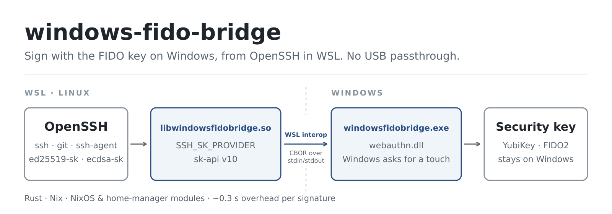

<div align="center">

# windows-fido-bridge

### Use the FIDO security key plugged into Windows from OpenSSH in WSL.

**`ssh`, `ssh-agent` and `git` commit signing with `ed25519-sk` / `ecdsa-sk` keys — no USB passthrough.**

[](https://github.com/aldoborrero/windows-fido-bridge/actions)
[](rust-toolchain.toml)
[](#nix)
[](#requirements)
[](LICENSE)

[Quick start](#quick-start) · [How it works](#how-it-works) · [Git signing](#git-commit-signing) · [age / sops](#age-and-sops-with-a-yubikey-piv) · [Troubleshooting](#troubleshooting) · [Development](#development)

<br />



</div>

## Why

Passing a YubiKey into WSL with `usbipd` makes FIDO fragile: `pcscd` and libfido2 fight over the device, signatures time out with `agent refused operation`, and the key disappears from Windows while it is attached.

windows-fido-bridge leaves the key on Windows. OpenSSH in WSL hands each request to the bridge, the bridge asks the Windows WebAuthn API, and Windows shows its own "touch your security key" prompt. Keys you already enrolled with libfido2 keep working — no re-enrollment, nothing to change on GitHub or your servers.

## Quick start

### Nix

```bash
nix build github:aldoborrero/windows-fido-bridge
export SSH_SK_PROVIDER=$PWD/result/lib/libwindowsfidobridge.so

ssh-keygen -Y sign -n git -f ~/.ssh/id_ed25519_sk message   # Windows asks for a touch
ssh -i ~/.ssh/id_ed25519_sk user@host
```

### NixOS / home-manager

```nix
# flake.nix
inputs.windows-fido-bridge.url = "github:aldoborrero/windows-fido-bridge";

# NixOS (e.g. a NixOS-WSL host, with programs.ssh.startAgent)
imports = [ inputs.windows-fido-bridge.nixosModules.windows-fido-bridge ];
programs.windows-fido-bridge.enable = true;

# or home-manager (with services.ssh-agent)
imports = [ inputs.windows-fido-bridge.homeModules.windows-fido-bridge ];
programs.windows-fido-bridge.enable = true;
```

The module exports `SSH_SK_PROVIDER` and allows the bridge in `ssh-agent` (`-P`). Open a new shell afterwards so it picks up the variable.

### Without Nix

```bash
cargo build --release -p sk-middleware                                         # needs glibc ≥ 2.34
cargo build --release -p webauthn-bridge --target x86_64-pc-windows-gnu        # needs a mingw-w64 linker
install -D target/release/libwindowsfidobridge.so ~/.local/lib/wfb/libwindowsfidobridge.so
install -D target/x86_64-pc-windows-gnu/release/windowsfidobridge.exe ~/.local/lib/wfb/windowsfidobridge.exe
export SSH_SK_PROVIDER=~/.local/lib/wfb/libwindowsfidobridge.so
```

The library always looks for `windowsfidobridge.exe` **next to itself**, so keep the two files together.

## Requirements

- WSL 2 on Windows 10 1903+ or Windows 11
- OpenSSH ≥ 9.1 in WSL (security key API v10)
- A FIDO2/U2F key that supports Ed25519 or ECDSA P-256 (tested with YubiKey 5 NFC and 5C NFC)
- The key attached to **Windows** — if `usbipd` has it attached to WSL, Windows cannot see it

## How it works

It is an [OpenSSH security key middleware](https://github.com/openssh/openssh-portable/blob/master/PROTOCOL.u2f) in two halves:

| Piece | Runs on | Role |
| --- | --- | --- |
| `libwindowsfidobridge.so` | WSL (Linux) | Loaded by OpenSSH through `SSH_SK_PROVIDER`; implements `sk-api.h` |
| `windowsfidobridge.exe` | Windows | Started by the library through WSL interop; calls `webauthn.dll` |

The library sends one CBOR request over the child's stdin and reads one reply from its stdout — the same wire protocol as the [C++ implementation](https://github.com/socram8888/windows-fido-bridge), so either half can be swapped with its upstream counterpart.

**Performance:** the WSL → Windows hop costs about 0.1–0.3 s per operation (starting the `.exe` through interop); turning the touch into a signature takes a few milliseconds. The rest is the Windows prompt and your finger.

## Usage

```bash
# sign / authenticate with an existing key
ssh-keygen -Y sign -n git -f ~/.ssh/id_ed25519_sk message
ssh -i ~/.ssh/id_ed25519_sk user@host

# enroll a new key (Windows asks for a touch, and for the PIN with verify-required)
ssh-keygen -t ed25519-sk -f ~/.ssh/id_ed25519_sk
ssh-keygen -t ecdsa-sk -O verify-required -f ~/.ssh/id_ecdsa_sk
ssh-keygen -t ed25519-sk -O user=alice                      # user name shown by Windows

# through ssh-agent: allow the provider path (default allow-list is /usr/lib* only)
ssh-agent -P '/nix/store/*'
ssh-add ~/.ssh/id_ed25519_sk                               # uses $SSH_SK_PROVIDER
```

Enrollment only offers external security keys — Windows will not try to save a Windows Hello passkey — and keeps the flags you asked for, so `-O verify-required` keys always ask for the PIN.

| Environment variable | Effect |
| --- | --- |
| `WINDOWS_FIDO_BRIDGE_DEBUG` | any value: debug logs from both halves on stderr (the PIN is never logged) |
| `WINDOWS_FIDO_BRIDGE_FORCE_USER_VERIFICATION` | any value: always require PIN or biometric verification |

Both are forwarded to Windows through `WSLENV`. Using the application `ssh:windows-fido-bridge-verify-required` (`ssh-keygen -O application=...`) also requires verification for that key.

List the serial numbers of the YubiKeys attached to Windows — one decimal per line, read over PC/SC, no window and no touch:

```bash
"$(dirname "$SSH_SK_PROVIDER")/windowsfidobridge.exe" --list-serials
```

## Git commit signing

Git signs through `ssh-keygen -Y sign`, so it works as soon as `SSH_SK_PROVIDER` is set:

```bash
git config --global gpg.format ssh
git config --global commit.gpgsign true
git config --global user.signingKey ~/.ssh/id_ed25519_sk.pub
```

With several YubiKeys, [gfh](https://github.com/aldoborrero/gfh) picks the key that is plugged in: under WSL it reads the serials with `--list-serials`, then loads the matching key into `ssh-agent` through the bridge.

## age and sops with a YubiKey (PIV)

The same YubiKey can decrypt [age](https://age-encryption.org) files encrypted to its [`age-plugin-yubikey`](https://github.com/str4d/age-plugin-yubikey) recipient (`age1yubikey1…`, a PIV slot) — and so [sops](https://github.com/getsops/sops) files that list it. In WSL the Linux plugin finds no smart card reader (`Could not open YubiKey with serial …`); this flake builds the upstream plugin for Windows, where it reaches the key through the Smart Card service, and puts a shim named `age-plugin-yubikey` on `PATH` that runs it through WSL interop.

```nix
programs.windows-fido-bridge.age.enable = true;   # NixOS or home-manager; independent of `enable`
```

or, without the modules:

```bash
nix build github:aldoborrero/windows-fido-bridge#age-plugin-yubikey-wsl
export PATH=$PWD/result/bin:$PATH
```

Then use age and sops as usual, with the identity stubs of your keys:

```bash
age-plugin-yubikey --identity > ~/yubikey-identities.txt   # stubs + recipients, no PIN or touch
age -d -i ~/yubikey-identities.txt secret.age
SOPS_AGE_KEY_FILE=~/yubikey-identities.txt sops -d secrets.sops.yaml
```

The age client asks for the PIV PIN in the WSL terminal (the plugin sends it a `request-secret`), and the YubiKey blinks when it needs a touch — the plugin prints nothing while it waits. `RUST_LOG=debug` is forwarded to the plugin for its logs.

| Piece | Runs on | Role |
| --- | --- | --- |
| `bin/age-plugin-yubikey` | WSL (Linux) | Shim found by age on `PATH`; `exec`s the `.exe`, passing arguments, stdin/stdout/stderr and the exit status through |
| `lib/age-plugin-yubikey.exe` | Windows | Upstream `age-plugin-yubikey` 0.5.1, built from source; talks to the PIV applet over WinSCard |

The shim must come **first** on `PATH`: age has no other way to choose a plugin, and a Linux `age-plugin-yubikey` (for example from `nix-shell -p age-plugin-yubikey`) shadows it. The modules install it with high priority; shells that prepend their own copy need it removed on WSL.

## Troubleshooting

| Symptom | Cause and fix |
| --- | --- |
| `agent refused operation` when signing through `ssh-agent` | The agent rejects the provider path. Start it with `-P` covering the library (the NixOS / home-manager modules do this). |
| Windows asks you to insert a security key although one is plugged in | It is attached to WSL with `usbipd`. Run `usbipd detach --busid <id>` so Windows sees it. |
| `Couldn't sign message: invalid format` right after pressing Cancel | Expected: OpenSSH reports every bridge failure as a generic error. Run with `WINDOWS_FIDO_BRIDGE_DEBUG=1` to see the Windows `HRESULT`. |
| `[linux-middleware] [error] …/windowsfidobridge.exe: No such file or directory` | The `.exe` is not next to the `.so` (e.g. `SSH_SK_PROVIDER` points at a symlink of the library alone). |
| `yubikey plugin: Could not open YubiKey with serial …` in WSL | The Linux plugin ran, not the shim: `command -v age-plugin-yubikey` must print the bridge's `bin/age-plugin-yubikey`. Also check the key is attached to Windows and the Smart Card service (`SCardSvr`) runs. |
| A new shell does not use the bridge | `SSH_SK_PROVIDER` is not exported there; with the modules, log in again or open a new terminal. |

## Limitations

- Resident (discoverable) keys are not supported: `-O resident` is ignored and `ssh-keygen -K` finds nothing.
- No timeout: the Windows prompt waits until you touch or cancel.
- Bridge errors reach OpenSSH as a generic failure; PIN-required and device-not-found are not told apart.

These are tracked in [`specs/001-rust-rewrite/tasks.md`](specs/001-rust-rewrite/tasks.md) (T051, T053, T054).

## Differences from the C++ implementation

Same wire protocol and behaviour, plus fixes found in review and on hardware:

- Enrollment returns the requested flags, so `verify-required` survives into the key file (upstream stored `0`, silently dropping PIN verification).
- Enrollment is restricted to cross-platform authenticators with direct attestation (no Windows Hello prompt).
- ECDSA signatures with short `r`/`s` (about 1 in 128) are accepted instead of failing at random.
- Memory is freed on error paths; oversized requests, inherited file descriptors and invalid UTF-8 are rejected instead of misbehaving.
- The Windows executable is a console program, so its diagnostics reach the WSL terminal.

The full list with rationale is in [`specs/001-rust-rewrite/research.md`](specs/001-rust-rewrite/research.md) (R12).

## Development

```bash
direnv allow        # or: nix develop
just                # list recipes
just test           # cargo test --workspace
just lint           # clippy for Linux and the Windows target
just build          # nix build: .so + .exe into ./result/lib
just try-sign       # sign a test message through the bridge (key attached to Windows)
just try-age        # decrypt a test file through the age plugin (key attached to Windows)
just upstream       # clone the C++ reference into .scratch/
just worktree feat  # new branch in .worktrees/feat
```

Rust is built with [crane](https://github.com/ipetkov/crane); the toolchain is pinned in `rust-toolchain.toml` and comes from [rust-overlay](https://github.com/oxalica/rust-overlay); the Windows executable is cross-compiled to `x86_64-pc-windows-gnu` with nixpkgs' mingw-w64. `nix flake check` runs everything CI runs: build, tests, clippy for both targets, formatting and the NixOS module check. Specs and plans live in [`specs/`](specs/) ([Spec Kit](https://github.com/github/spec-kit)).

## Acknowledgments

A Rust rewrite of [windows-fido-bridge](https://github.com/mgbowen/windows-fido-bridge) by Matthew Bowen and contributors, continued by [socram8888](https://github.com/socram8888/windows-fido-bridge). See [NOTICE](NOTICE).

## License

Apache License 2.0 — see [LICENSE](LICENSE).
